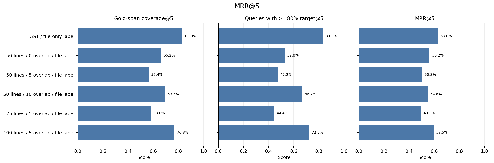
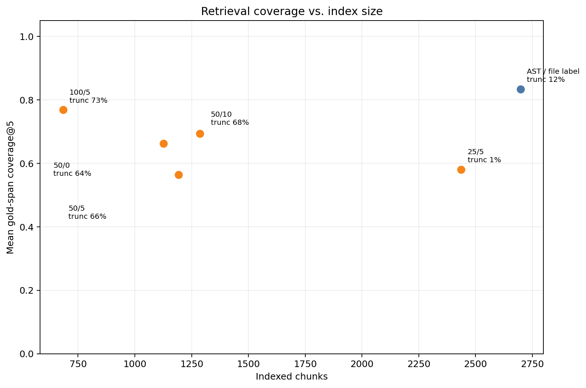
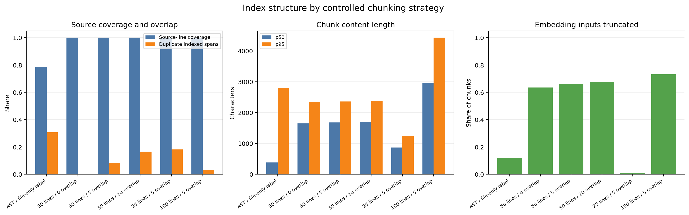
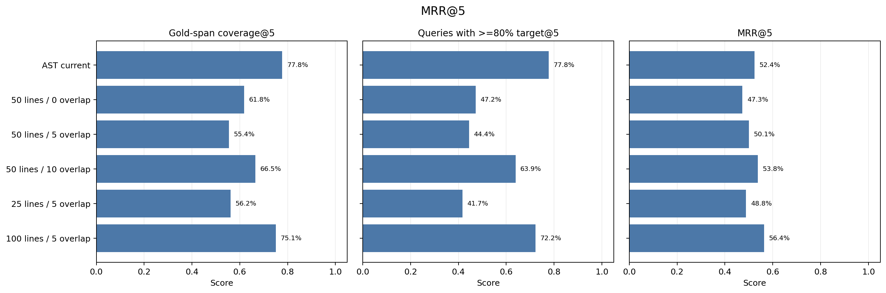
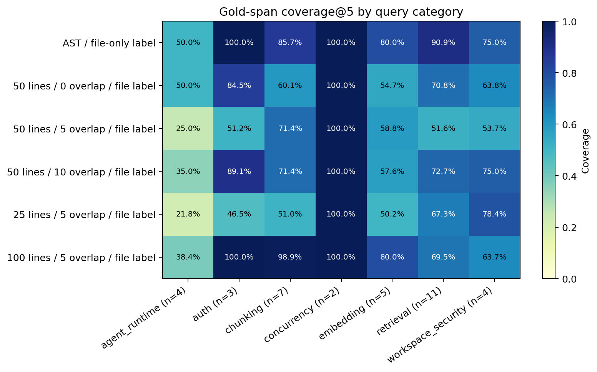
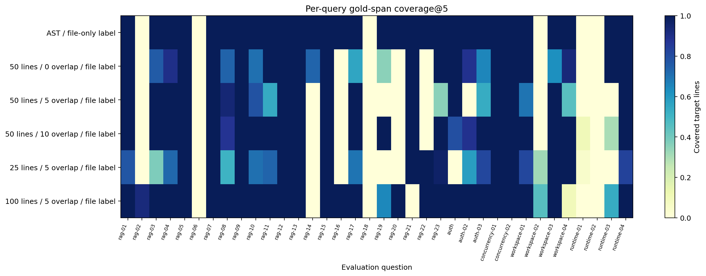

# Code chunking ablation: results summary

## Result at a glance

Across 36 hand-authored source-grounded queries, the highest mean target-span coverage@5 was **AST / file-only label (83.3%)**. The highest MRR@5 was **AST / file-only label (0.630)**. Relative to the controlled AST reference, the best observed coverage difference was +0.0 percentage points and the best MRR difference was +0.000.

These are results on this local repository snapshot and this hand-authored dataset. They are not production traffic measurements or evidence of general superiority.

## Main metrics

| Controlled strategy (common file-only label) | Chunks | File hit@5 | Any target overlap@5 | >=80% target coverage@5 | Mean target coverage@5 | MRR@5 | Source lines indexed | Duplicate line spans | Embedding input truncated | Index build |
|---|---:|---:|---:|---:|---:|---:|---:|---:|---:|
| AST / file-only label | 2698 | 86.1% | 83.3% | 83.3% | 83.3% | 0.630 | 78.5% | 30.7% | 11.9% | 129.8s |
| 50 lines / 0 overlap / file label | 1127 | 83.3% | 75.0% | 52.8% | 66.2% | 0.562 | 100.0% | 0.0% | 63.5% | 78.7s |
| 50 lines / 5 overlap / file label | 1193 | 83.3% | 63.9% | 47.2% | 56.4% | 0.503 | 100.0% | 8.3% | 66.2% | 83.8s |
| 50 lines / 10 overlap / file label | 1286 | 86.1% | 75.0% | 66.7% | 69.3% | 0.548 | 100.0% | 16.7% | 67.7% | 91.6s |
| 25 lines / 5 overlap / file label | 2437 | 86.1% | 72.2% | 44.4% | 58.0% | 0.493 | 100.0% | 18.2% | 0.9% | 129.3s |
| 100 lines / 5 overlap / file label | 684 | 86.1% | 83.3% | 72.2% | 76.8% | 0.595 | 100.0% | 3.5% | 73.2% | 48.7s |

## Native metadata comparison

The initial end-to-end comparison retained the source's native names: AST chunks carry symbol names, while fixed windows carry filename-and-line-range names. These values are included in embeddings and BM25, so this is useful as a current-implementation comparison but does not isolate boundaries. The controlled table above normalizes that field to the filename for every strategy.

| Native strategy | Chunks | File hit@5 | Mean target coverage@5 | MRR@5 | Embedding input truncated |
|---|---:|---:|---:|---:|---:|
| AST current | 2698 | 80.6% | 77.8% | 0.524 | 11.9% |
| 50 lines / 0 overlap | 1127 | 83.3% | 61.8% | 0.473 | 63.5% |
| 50 lines / 5 overlap | 1193 | 83.3% | 55.4% | 0.501 | 66.2% |
| 50 lines / 10 overlap | 1286 | 86.1% | 66.5% | 0.538 | 67.7% |
| 25 lines / 5 overlap | 2437 | 83.3% | 56.2% | 0.488 | 0.9% |
| 100 lines / 5 overlap | 684 | 83.3% | 75.1% | 0.564 | 73.2% |

## Slice and per-question behavior

See [case analysis](case-analysis.md) for concrete questions where methods disagreed. Full results, including top-five chunks and per-category values, are in [results.json](results.json).

## How to read the metrics

- **Any target overlap@5** is intentionally permissive: at least one returned chunk intersects the annotated method/class lines.
- **>=80% target coverage@5** requires the union of the top-five source ranges to cover at least 80% of the target symbol.
- **Mean target coverage@5** measures how much of the annotated symbol the top five collectively expose.
- **MRR@5** uses the rank of the first result that overlaps the target symbol by at least one line.
- **Embedding input truncated** counts a chunk when the indexer's 1500-character pre-clip removes source text or when the cleaned, name-prefixed input exceeds the embedder cap; it is not tokenizer-measured.
- **Index build** is local chunking + embedding + in-memory index loading after a model warm-up. It is hardware-specific and includes this run's sequential execution conditions.
- The hybrid retriever uses truncated embedding text for vector similarity but indexes the full chunk text for BM25. These results compare the full hybrid pipeline; they do not attribute gains to vector search alone.

## What the measured trade-offs suggest

- The controlled AST strategy covers **83.3%** of target lines on average and gives at least 80% coverage for **83.3%** of queries. It indexes **78.5%** of source lines, with **30.7%** duplicated indexed line spans from nested/overlapping syntax units.
- At 50 lines, overlap is not monotonic: 0/5/10 lines produce mean target coverage of **66.2% / 56.4% / 69.3%**. Five lines is the weakest of these three in this run.
- 100/5 is the strongest fixed-window option here: **76.8%** mean target coverage, **0.595 MRR@5**, and 684 chunks. But **73.2%** of its embedding inputs are truncated, so its hybrid result does not prove the vector representation sees the full window.
- 25/5 nearly eliminates truncation (**0.9%**) but yields **58.0%** target coverage and creates 2437 chunks. Small chunks reduce truncation but can fragment the code needed to answer a query.
- AST's source-line coverage gap is a separate retrieval risk: recognized syntax nodes are indexed, so top-level imports, constants, and other code outside those nodes can be absent when a file already produced AST chunks.

Category samples are small (2–11 queries per category); slice values are diagnostic, not stable quality estimates. No confidence interval or statistical-significance claim is made.

## Scope and reproducibility

- Model: local `mxbai-embed-large:latest` (468836162de7); no generator, reranker, or external model call was used.
- The embedding weight was already installed locally; no model was downloaded and no Chinese open-source model was invoked.
- Retriever: current in-memory vector + BM25 + RRF path; top-k=5.
- Source snapshot: commit `702b845adb486cb3d1c1d8a412b77f7e05f9a99b` plus working-tree source hash `50f5b8c05a08a5d121054b61453dd7973102952ae5838bda4c8138e95ab36f7c`.
- Indexed source files: 350; query dataset: `repo-code-search-v1`.
- Corpus is code-only: `.java, .js, .py, .ts, .tsx` under the listed Python, Java, and frontend source roots; Markdown/PDF/other RAG documents were not evaluated.
- Dataset is manually authored from source code, not collected from real users. Gold spans are AST-resolved by symbol and line hint, which makes the set symbol-centric and may favor AST-style boundaries.
- The current 1500-character embedding cap and the overlapping class/method AST chunks are part of the measured baseline, not held out as separate fixes.
