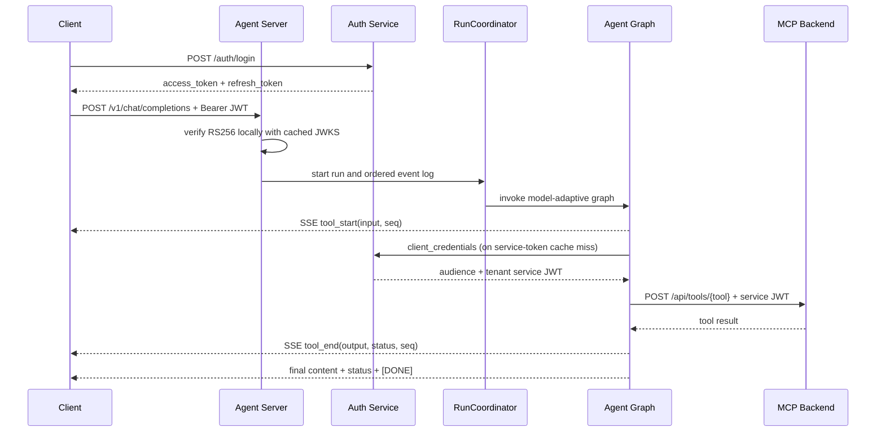

# API Reference — AI Coding Agent Platform

## Overview

| Service | Port | Base URL | Description |
|---------|------|----------|-------------|
| Agent Server (Python) | 8500；本地 UI profile 使用 8580 | `http://localhost:${AGENT_PORT}` | 主入口，OpenAI 兼容接口 + 管理 API |
| Auth Service (Java) | 8090 | `http://localhost:8090` | RS256 JWT 认证中心 |
| Memory Server (Java) | 8180 | `http://localhost:8180` | 持久化记忆存储 + TF-IDF 搜索 |
| Code Exec Server (Java) | 8380 | `http://localhost:8380` | Docker 沙箱代码执行 |

---

## 认证与状态约定

- 除 `/health`、Auth 公共端点、静态 UI 和 `/api/agents` 外，Agent API 均要求 Bearer access JWT。
- Agent 在本地校验 RS256 签名、issuer、audience 和必需 claims。`/auth/jwks` 仅在启动预热或缓存刷新时访问，不是每个请求的远程认证调用。
- Agent `session_id` 只标识对话/checkpoint 连续性，不能证明身份；身份与 tenant 只来自已验证 JWT。
- Auth refresh-token 数据库记录表示登录 session。每次 refresh 原子撤销旧 token，并同时返回新的 access/refresh token pair。
- Agent 调用 Java MCP 服务时使用 `client_credentials` 获取目标 audience 的 service JWT，tenant 通过 JWT claim 传播。

### 三类运行状态

| 状态 | 标识 | 所有者 | 用途 |
|---|---|---|---|
| 登录 session | refresh-token row | Auth Service | 登录连续性、rotation、logout revocation |
| Agent 对话 | `session_id` | conversation/checkpoint layer | 多轮上下文；tenant-prefixed，但不是认证凭证 |
| Runtime run | `run_id` | RunCoordinator/runtime store | 单次执行、事件、取消、审批、恢复与审计 |

---

## 场景分类

### 🔐 Scene 1: 认证与会话管理

| Method | Endpoint | Service | Description |
|--------|----------|---------|-------------|
| POST | `/auth/signup` | Auth | 用户注册 |
| POST | `/auth/login` | Auth | 用户登录（返回 JWT + refresh_token） |
| POST | `/auth/token` | Auth | OAuth2 token（client_credentials / password grant） |
| POST | `/auth/refresh` | Auth | 原子 rotation，返回新 access_token + refresh_token |
| POST | `/auth/logout` | Auth | access token 加黑名单，并撤销该用户 refresh sessions |
| POST | `/auth/register` | Auth | 注册 M2M 客户端（需 ADMIN） |
| GET | `/auth/jwks` | Auth | JWKS 公钥端点（服务间验证） |
| GET | `/auth/check-blacklist?jti=xxx` | Auth | 检查 token 是否被吊销 |
| GET | `/auth/health` | Auth | 健康检查 |

### 💬 Scene 2: AI 对话（核心业务流）

| Method | Endpoint | Service | Description |
|--------|----------|---------|-------------|
| GET | `/api/agents` | Agent | UI-safe Agent catalog（公开，不暴露 prompt/tool policy） |
| POST | `/v1/chat/completions` | Agent | OpenAI 兼容聊天；支持 SSE，响应头返回 `X-Run-ID` |
| GET | `/v1/models` | Agent | 列出可用模型（需认证） |

SSE 使用 named events。`tool_start` 包含 `tool`、`seq` 和实际输入；`tool_end`
包含同一 `seq`、截断后的输出与 `ok/error` 状态。前端据此按真实顺序显示路径、
行号、搜索词、命令或代码，而不是把工具名当作不透明状态。

### Runtime 控制面

以下端点全部要求 access JWT，并校验 run/approval/session 属于当前 tenant。

| Method | Endpoint | Description |
|--------|----------|-------------|
| GET | `/v1/runs/{run_id}/events?after_seq=0` | 按 cursor 查询持久化有序事件与终止原因 |
| GET | `/v1/runs/{run_id}/checkpoint` | 查询 run checkpoint |
| GET | `/v1/runtime/recoverable` | 列出当前 tenant 可恢复 checkpoints |
| POST | `/v1/runs/{run_id}/resume` | 通过 lease 恢复 approved 或 model-retry checkpoint |
| POST | `/v1/runs/{run_id}/cancel` | 协作取消 root run 与活动 graph task |
| GET | `/v1/approvals/{approval_id}` | 查询审批状态 |
| POST | `/v1/approvals/{approval_id}/decision` | 提交 `approved` 或 `rejected` |
| POST | `/v1/sessions/{session_id}/children/{child_id}/cancel` | 协作取消 tenant-owned child agent |

### 🧠 Scene 3: 记忆管理（MCP Tools）

| Method | Endpoint | Service | Description |
|--------|----------|---------|-------------|
| POST | `/api/tools/memory_set` | Memory | 写入记忆 |
| POST | `/api/tools/memory_get` | Memory | 读取记忆 |
| POST | `/api/tools/memory_search` | Memory | TF-IDF 搜索记忆 |
| POST | `/api/tools/memory_delete` | Memory | 删除记忆 |
| POST | `/api/tools/memory_list` | Memory | 列出所有记忆 |
| POST | `/api/tools/memory_pin` | Memory | 置顶/取消置顶 |
| POST | `/api/tools/memory_context` | Memory | 记忆系统概览 |

### 🎓 Scene 4: 技能存储（Skill Store）

| Method | Endpoint | Service | Description |
|--------|----------|---------|-------------|
| POST | `/api/tools/skill_set` | Memory | 保存技能 |
| POST | `/api/tools/skill_get` | Memory | 获取技能 |
| POST | `/api/tools/skill_list` | Memory | 列出技能 |
| POST | `/api/tools/skill_history` | Memory | 技能版本历史 |
| POST | `/api/tools/skill_rollback` | Memory | 回滚技能版本 |
| POST | `/api/tools/skill_feedback` | Memory | 技能使用反馈 |
| GET | `/api/tools/skill_triggers` | Memory | 技能触发规则 |

### 🖥️ Scene 5: 代码执行

| Method | Endpoint | Service | Description |
|--------|----------|---------|-------------|
| POST | `/api/tools/code_run` | CodeExec | 运行代码（Docker 隔离） |
| POST | `/api/tools/code_shell` | CodeExec | 执行 shell 命令 |

CodeExec 端点只接受具有 `ROLE_SERVICE` 的 service JWT。当前 sandbox 支持
Python、JavaScript 和 Alpine shell standalone snippets；容器使用 no-network、
read-only root、CPU/内存/PID 限制，且**不挂载当前 Agent workspace**。因此它
不是 `run_project` API，不能用来启动或读取当前项目。workspace 内测试由 Agent
的 `run_tests` 工具执行并回传实际命令。

### 📁 Scene 6: 工作区管理

| Method | Endpoint | Service | Description |
|--------|----------|---------|-------------|
| GET | `/api/workspace/current` | Agent | 当前工作区路径 |
| POST | `/api/workspace/open` | Agent | 打开工作区 |
| GET | `/api/workspace/browse?path=xxx` | Agent | 浏览目录 |
| GET | `/api/workspace/files` | Agent | 列出文件 |
| GET | `/api/workspace/file?path=xxx` | Agent | 读取文件内容 |

这些端点均要求 access JWT。多租户模式下，`open`/`browse` 被限制在该 tenant 的
隔离根目录；单用户本地进程可显式设置 `AGENT_MULTI_TENANT_WORKSPACE=false`，
在允许的 home/tmp roots 中切换项目。Agent 工具只接受相对 workspace 路径，
并拒绝 traversal 与逃逸 symlink。

### 📊 Scene 7: 运维与可观测性

| Method | Endpoint | Service | Description |
|--------|----------|---------|-------------|
| GET | `/health` | Agent | 健康检查 |
| GET | `/metrics` | Agent | 全局请求指标（QPS、延迟，需 Bearer JWT 与 `*` 权限） |
| GET | `/api/usage` | Agent | Token 用量与成本 |
| GET | `/api/prompts` | Agent | Prompt 版本与灰度配置 |
| GET | `/v1/runs/{run_id}/events?after_seq=0` | Agent | 查询 runtime run 事件流（按 tenant 隔离，支持 cursor） |
| POST | `/api/feedback` | Agent | 记录 tenant/user/run/retrieval-trace 关联的显式反馈 |
| GET | `/api/reranker` | Agent | Reranker 权重信息 |
| POST | `/api/reranker/retrain` | Agent | 生成候选权重（需 `*` 权限） |
| POST | `/api/reranker/promote` | Agent | 提升候选并保留 rollback 状态（需 `*`） |
| POST | `/api/reranker/rollback` | Agent | 恢复上一版本（需 `*`） |
| POST | `/api/reranker/promote-gated` | Agent | 仅在 held-out evaluation 达标时提升（需 `*`） |
| GET | `/api/reranker/evaluate` | Agent | 评估 reranker 效果 |
| GET | `/api/analytics` | Memory | 事件分析统计 |

---

## 时序图

### 完整对话流程



### 认证流程泳道图

```mermaid
sequenceDiagram
   participant C as Client
   participant A as Agent Server
   participant Auth as Auth Service
   C->>Auth: login
   Auth-->>C: access + refresh
   C->>A: protected request + access JWT
   opt startup/cache expiry
      A->>Auth: GET /auth/jwks
      Auth-->>A: active RSA keys
   end
   A->>A: verify once; cache marked AuthContext on request
   A-->>C: tenant-authorized response
   C->>Auth: refresh(old refresh token)
   Auth->>Auth: lock user/token, revoke old, create new
   Auth-->>C: new access + new refresh
   C->>Auth: logout(access token)
   Auth->>Auth: blacklist access jti + revoke refresh sessions
```

Agent Server 当前不对每个 access JWT 查询 blacklist；当 blacklist enforcement
不可达或未接入时，已签发 access token 最长可使用到其短 TTL 到期。refresh
session 的服务端撤销不受此限制。

### 多租户隔离泳道

```text
verified JWT tenant_id
   -> request AuthContext / ContextVar
   -> tenant-prefixed conversation + LangGraph thread
   -> immutable workspace snapshot on each run
   -> tenant-owned run / event / checkpoint / approval records
   -> audience-specific service JWT for Java MCP calls
   -> tenant metadata in observer and audit events
```
