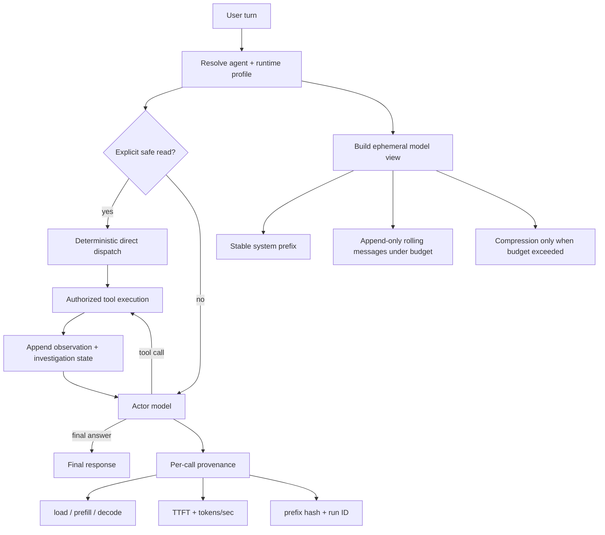

# A Cache-Aware Runtime for Local Coding Agents

## Design, Refactoring, and Mechanistic Evaluation of the MCP Agent Platform

**Technical Report TR-2026-08-26**<br>
**Date:** 26 August 2026<br>
**Artifact:** `mcp-agent-platform`<br>
**Status:** Reproducible exploratory engineering report

---

## 中文摘要

本报告研究本地 coding agent 的一个核心系统问题：当 agent 以“模型决策—工具执行—结果回填”的方式循环工作时，性能瓶颈往往不只是逐 token 解码，而是重复 prefill、不必要的模型规划调用、不稳定的 prompt 前缀，以及在单一推理后端上的并发竞争。本文以 JetBrains 对 Junie Local 的公开工程总结为灵感来源 [1]，结合 Transformer KV-cache、Prompt Cache、RadixAttention、ReAct 与 Amdahl 定律，独立重构了 MCP Agent Platform 的可审计 Python/LangGraph runtime。Junie 核心并未开源；本文没有复制、反编译或移植其 agent 实现。

重构内容包括本地模型 runtime profile、只读工具的保守确定性路由、预算内 append-only 的滚动上下文、稳定前缀指纹，以及 load/prefill/decode/TTFT 的 provider-native provenance。确定性 A/B 表明，直接路由在最终答案完全一致时将 actor 模型调用从 2 次降低为 1 次。自动 runner 在每组实验前卸载模型，并完整保留两组 Ollama/Qwen2.5-7B 结果；warm follow-up 的 prompt token 数增加 5.4%，但 prefill 降低 99.2-99.4%，agent 内部首 chunk 时间降低 97.7-98.6%，HTTP 总延迟降低 85.3-89.2%，且 4,910 字符的系统前缀哈希保持一致。该现象与当前协议下的服务端 prefix reuse 一致，但不能单独证明 provider 的 cache key，也不能把全部收益唯一归因于本次重构。最终全仓执行 1,164 项测试，其中 1,163 项通过、1 项跳过、0 项失败。由于 live 样本仅有两组，结论应视为探索性机制证据，而非跨模型、硬件和任务分布的统计推广。

**关键词：** coding agent；本地推理；KV cache；prompt cache；ReAct；工具路由；prefill；TTFT；LangGraph；Qwen

---

## Abstract

Local coding agents expose a performance regime that differs materially from
cloud-hosted agents. In a tool-using loop, latency is not determined only by
output-token generation: repeated prompt prefill, redundant model-mediated tool
selection, unstable prompt prefixes, and auxiliary model calls can dominate the
critical path. This report presents a cache-aware refactoring of the MCP Agent
Platform's Python coding-agent runtime. The work was inspired by JetBrains'
public description of the Junie Local optimization stack [1], but was designed
and implemented independently against an inspectable LangGraph runtime. No
Junie agent source code was used; the public Junie repository distributes
installers and proprietary binaries under an all-rights-reserved license [16].

The refactoring introduces four principal mechanisms: (i) a model-adaptive
runtime profile that disables local subagent fan-out and binds context budgets
at graph construction; (ii) conservative deterministic dispatch for
high-confidence read-only tools; (iii) append-only rolling context under budget
with stable-prefix fingerprinting; and (iv) provider-native observability for
load, prefill, decode, time-to-first-token (TTFT), and prefix identity. It also
adds a warm-cache benchmark that joins OpenAI-compatible chat responses to
runtime provenance events through explicit run identifiers.

Evaluation combines a deterministic graph-level A/B experiment, two automated
cold/warm pairs using Ollama and Qwen2.5-7B, and the repository-wide regression
suite. Deterministic direct dispatch reduced actor-model calls from two to one
without changing the final answer. In two cold-reset live samples, a follow-up
prompt containing 5.4% more input tokens reduced prefill time by 99.2-99.4%,
internal actor-stream TTFT by 97.7-98.6%, and end-to-end HTTP latency by 85.3-89.2%, while preserving
an identical 4,910-character system-prefix hash. The final validation executed
1,164 tests: 1,163 passed, one was skipped, and none failed. These results are
mechanistic evidence that deterministic read routing works as specified and
that the observed local-inference behavior is consistent with server-side
prefix reuse under this protocol. They are neither a statistically powered
claim across models, repositories, or hardware nor an isolated causal estimate
of the refactoring.

**Keywords:** coding agents, local inference, KV cache, prompt caching, ReAct,
tool routing, prefill latency, TTFT, LangGraph, Qwen, Ollama

---

## 1. Introduction

### 1.1 Motivation

A coding agent is a stateful language-model program rather than a single model
call. A typical turn alternates between model decisions, tool execution, and
observations:

$$
\tau = (u_0, a_1, o_1, a_2, o_2, \ldots, y),
$$

where $u_0$ is user input, $a_i$ is either a tool call or a language action,
$o_i$ is an environment observation, and $y$ is the final answer. This is the
operational form of the interleaved reasoning-and-acting pattern studied by
ReAct [4]. Toolformer further establishes that deciding whether, when, and how
to invoke an external API is itself part of the language-model task [5].

For a remote frontier model, repeated prefill and extra helper calls may be
masked by datacenter hardware and provider-level caching. On a local model,
those costs are paid on the user's critical path. JetBrains reported this
phenomenon while adapting Junie to local Qwen inference: file investigation was
prefill-dominated, rolling context enabled KV-cache reuse, stable initial
prefixes improved reuse across tasks, and optional model calls and multi-agent
execution were disabled for the serialized local backend [1]. This public
engineering account motivated the present work.

The central question is therefore not merely "How many tokens per second can
the model decode?" It is:

> How should the agent harness be structured so that a local inference server
> performs the minimum necessary model work while preserving task semantics?

### 1.2 Research Questions

This report addresses four research questions.

- **RQ1:** Can a conservative deterministic router remove a model planning hop
  for explicit read-only requests without changing the answer?
- **RQ2:** Can append-only rolling context and a stable system prefix produce
  observable prefill and TTFT reductions on a real local model?
- **RQ3:** Can provider-native timing and prefix provenance distinguish cache
  effects from shorter prompts, fewer output tokens, or measurement artifacts?
- **RQ4:** Can these changes be introduced without regressions across the
  platform's Python, Java, TypeScript, frontend, and Docker integration gates?

### 1.3 Contributions

The work makes the following contributions.

1. A local runtime profile whose graph-baked settings include tool-call budget,
   context budget, subagent eligibility, and deterministic routing.
2. A read-only direct-dispatch policy with strict extraction, validation,
   allowlisting, and LLM fallback.
3. A cache-friendly model-view contract: lossless checkpoint state,
   append-only message order under budget, and compression only in the
   ephemeral model view.
4. Provider-native performance provenance, including prefill/decode timing,
   token counts, TTFT classification, and stable-prefix hashes.
5. A reproducible warm-cache evaluation command and deterministic A/B tests.
6. Remediation of four unrelated test-gate defects uncovered by full-system
   validation: retired Python modules, transaction propagation, Spring AI API
   migration, and root TypeScript ownership.

---

## 2. Provenance of Ideas and Source Boundaries

### 2.1 Engineering Inspiration

The primary engineering inspiration was Erokhin's JetBrains article, "How We
Optimized the Qwen 3.6 Model for Our Junie Agent" [1]. The following ideas were
adapted at the design level:

| Publicly described idea | Independent adaptation in this project |
|---|---|
| Extend rolling context for local inference | Preserve complete prior messages and tool results while under budget |
| Maximize the reusable initial prefix | Keep one stable leading system message and record its SHA-256 |
| Remove optional model calls | Disable reflexion/verifier by default in the local profile; bypass a planning call for safe reads |
| Disable multi-agent mode on a serialized local backend | Remove `spawn_subagent` from the local profile's bound tools |
| Treat prefill separately from decode | Record provider-native load/prefill/decode/TTFT metrics |
| Adapt progress behavior per model | Add an opt-in, bounded tool-call-text progress adapter with reasoning filters |
| Disable reasoning for the selected local Qwen variant | Add an opt-in MLX `enable_thinking` request override |

Junie Local documentation also states that first-project responses pay initial
prefill cost and subsequent responses benefit from cached context [2].

### 2.2 What Was Not Copied

The Junie agent runtime is not available as open source. The public
`JetBrains/junie` repository consists predominantly of Shell, PowerShell, and
Batch installers and declares "All rights reserved" [16]. Its release artifacts
contain the executable agent. The `JetBrains-Hardware/junie-local` repository
similarly publishes installation logic and a binary inference-engine artifact
[17].

Accordingly:

- no Junie planner, agent-loop, context-manager, or tool implementation was
  imported or translated;
- no proprietary binary was reverse engineered;
- all runtime changes in this report were implemented against this repository's
  existing Python/LangGraph abstractions;
- JetBrains material is cited as design inspiration and external comparative
  evidence, not as incorporated source code.

### 2.3 Independent Theoretical Basis

The design is independently supported by published work:

- Transformer causal attention defines the K/V states whose reuse makes prefix
  caching possible [3].
- Prompt Cache explicitly reuses attention states for repeated system messages,
  templates, and documents, reducing TTFT without parameter changes [6].
- SGLang's RadixAttention generalizes automatic prefix reuse across structured
  language-model programs [7].
- PagedAttention formalizes efficient KV-cache storage and sharing across
  requests [8].
- ReAct and Toolformer motivate tool-mediated action loops [4], [5].
- Reflexion explains the potential quality benefit, and additional inference
  cost, of optional verbal self-feedback passes [11].
- Amdahl's law explains why concurrent agents cannot accelerate a critical path
  serialized at one inference backend [14].
- Spring's transaction model explains the observed rollback-only propagation
  and the `REQUIRES_NEW` remediation [15].

---

## 3. System Model

### 3.1 Runtime Before Refactoring

The active Python path was an explicit LangGraph ReAct loop:

```text
request
  -> reset turn state
  -> inject workspace/skills context
  -> intent router
  -> actor model
  -> tools
  -> error tracking / investigation state
  -> actor model
  -> final answer
```

However, several declared policies were not part of the effective graph
contract:

- `RuntimeProfile.max_context_chars` was parsed but not passed to the model view;
- `RuntimeProfile.allow_subagents` was parsed but did not change bound tools;
- deterministic routing was controlled globally rather than by profile;
- configured graph caching ignored profile changes;
- performance reporting exposed aggregate duration but not provider prefill and
  decode decomposition;
- the evaluation harness intentionally used fresh sessions and therefore could
  not test warm-context behavior.

### 3.2 Runtime After Refactoring



The durable checkpoint remains lossless. Context compression affects only the
request-specific model view and does not overwrite the source conversation.

### 3.3 Refactoring Scope

The implementation diff contains 32 tracked files with 764 insertions and 29
deletions, excluding generated reports and newly added test/benchmark files.
The principal ownership boundaries are:

- `app/agent/agent_graph`: execution topology and model view;
- `app/agent/execution_policy`: runtime-profile resolution;
- `app/agent/engine`: configured graph caching;
- `app/runtime`: transport-neutral execution and observations;
- `app/events`: stable provenance schema;
- `platform/eval-harness`: cold/warm measurement;
- Java and TypeScript modules: full-test remediation only.

---

## 4. Theoretical Analysis

### 4.1 Prefill and KV-Cache Reuse

For one self-attention head, Transformer attention is [3]:

$$
\operatorname{Attention}(Q,K,V)
= \operatorname{softmax}\left(\frac{QK^{\top}}{\sqrt{d_k}}\right)V.
$$

For a causal decoder at layer $\ell$, token representations produce keys and
values

$$
K^{(\ell)} = XW_K^{(\ell)}, \qquad
V^{(\ell)} = XW_V^{(\ell)}.
$$

Let a request consist of a stable prefix $P$ of length $p$ and a new suffix $S$
of length $s$. Without reuse, the server recomputes projections and causal
attention for $P \Vert S$. A comparable decoder-layer cost, suppressing
constants, is approximately

$$
C_{\text{cold}}
= O\left(L\left[(p+s)d^2 + (p+s)^2d\right]\right),
$$

for $L$ layers and model width $d$ after summing attention work across heads. If
the exact tokenized prefix and its positions are reusable, cached $K_P,V_P$
eliminate repeated prefix work:

$$
C_{\text{warm}}
= O\left(L\left[sd^2 + s(p+s)d\right]\right) + C_{\text{lookup}}.
$$

The exact complexity depends on implementation, kernels, and model architecture,
but the directional prediction is robust: for $s \ll p$, warm prefill should be
substantially lower even though the logical prompt may be longer. Prompt Cache
reports this mechanism for reusable prompt modules [6]; RadixAttention performs
prefix matching and KV reuse automatically [7].

This yields the first falsifiable prediction:

> If server-side prefix reuse contributes materially, rather than the result
> arising solely from a shorter logical prompt, then warm prompt-token count may
> stay equal or increase while prefill and internal TTFT fall.

That is exactly the pattern observed in Section 7.

### 4.2 Stable Prefix as a Cache-Key Contract

A necessary condition for exact prefix reuse is token-sequence equality:

$$
\operatorname{Tok}(P_1) = \operatorname{Tok}(P_2).
$$

Byte equality of the system message under a fixed tokenizer implies equal input
text, though it is not by itself sufficient to prove provider-level cache reuse:
tool schemas, chat templates, model identity, positions, and server policy must
also remain compatible. The runtime therefore records

$$
h_P = \operatorname{SHA256}(P), \qquad |P|_{\text{chars}},
$$

as provenance, and interprets it together with provider-native prefill metrics.
The hash is an observability invariant, not a claim that SHA-256 is the provider's
cache key.

### 4.3 Deterministic Dispatch as Partial Evaluation

For an explicit read request, a generic ReAct path commonly performs:

$$
T_{\text{ReAct}}
= T_{\text{plan-LLM}} + T_{\text{tool}} + T_{\text{synth-LLM}}.
$$

If intent and arguments can be safely determined by a conservative pure
function $r(x)$, the first model decision is partially evaluated:

$$
T_{\text{direct}}
= T_{r} + T_{\text{tool}} + T_{\text{synth-LLM}},
$$

and therefore

$$
\Delta T
= T_{\text{ReAct}} - T_{\text{direct}}
\approx T_{\text{plan-LLM}} - T_r.
$$

Because regex classification is $O(|x|)$ on short prompts while local model
inference is orders of magnitude more expensive, the expected critical-path
saving is approximately one actor call.

Correctness is governed by asymmetric risk. Let $C_{FP}$ be the cost of an
incorrect dispatch and $C_{FN}$ the cost of missing an optimization. The expected
routing loss is

$$
\mathbb{E}[\mathcal{L}]
= P(FP)C_{FP} + P(FN)C_{FN} + C_r.
$$

For mutation or execution tools, $C_{FP}$ can be unbounded; for a bounded read,
it is usually an unnecessary observation. Read-only does not mean
non-sensitive: memory and retrieval tools can still disclose tenant data.
Hence the implementation restricts routing to a fixed read-only allowlist,
validates extracted arguments, rejects absolute paths and shell metacharacters,
verifies that the tool is actually bound, and still sends every invocation
through the ordinary authorization gate. Allowlist additions require a
side-effect and data-exposure review; ambiguous requests fall back to the model.
This preserves ReAct as the general policy while optimizing a controlled subset
[4].

### 4.4 Why Disable Local Subagent Fan-Out

Suppose a local inference server is the serial fraction $s$ of an agent task.
Amdahl's law bounds speedup under $N$ workers [14]:

$$
S(N) \le \frac{1}{s + (1-s)/N}.
$$

As $s \to 1$, $S(N) \to 1$: adding subagents cannot improve throughput at the
serialized model and can increase queueing, duplicated context, and memory
pressure. JetBrains reported disabling multi-agent mode for this reason on M5
local inference [1]. The local profile therefore removes `spawn_subagent`; cloud
or genuinely concurrent inference profiles may retain it.

This report validates that policy wiring, but does not claim a measured
multi-agent speedup comparison. Such an experiment requires controlled server
concurrency and is future work.

### 4.5 Latency Decomposition

We model per-call latency as

$$
T_{\text{call}}
= T_{\text{queue}} + T_{\text{load}} + T_{\text{prefill}}
+ T_{\text{decode}} + T_{\text{protocol}}.
$$

TTFT is approximately

$$
T_{\text{TTFT}}
= T_{\text{queue}} + T_{\text{load}} + T_{\text{prefill}}
+ T_{\text{first-decode}}.
$$

Ollama defines `load_duration`, `prompt_eval_count`,
`prompt_eval_duration`, `eval_count`, `eval_duration`, and `total_duration` in
nanoseconds [10]. The runtime records these fields rather than inferring prefill
from HTTP duration. The outer benchmark request is non-streaming, but the
LangChain actor emits internal `on_chat_model_stream` events. When such an event
contains content, TTFT is measured at the first actor-model chunk and marked
`ttft_estimated=false`; a dedicated observer regression test pins this behavior.
If no internal chunk is observed, `load + prefill` is recorded and explicitly
marked as an estimate. Thus the live tables report internal actor-stream TTFT,
not client-visible HTTP streaming TTFT.

---

## 5. Implementation

### 5.1 Runtime Profiles

The configured coding agent now declares a local profile:

```yaml
runtime:
  name: local-qwen-7b
  max_tool_calls: 20
  max_context_chars: 20000
  verification_enabled: false
  allow_subagents: false
  direct_tool_routing_enabled: true
```

The graph factory resolves the profile once and uses it to:

- filter `spawn_subagent` from bound tools;
- set graph step limits;
- set model-view context budget;
- configure the deterministic router.

Reflexion-style answer criticism remains available as an opt-in quality
mechanism [11], but is disabled in the local profile because it adds at least
one auxiliary model call and was not part of the measured treatment.

Boolean fields are parsed strictly, preventing a YAML string such as `"false"`
from becoming truthy through Python's generic `bool()` coercion.

### 5.2 Graph Cache Correctness

Runtime settings are baked into a compiled LangGraph. Reusing a graph after its
profile changes would silently retain stale tool and routing policy. The agent
registry now hashes the graph contract (model, prompt, tools, guardrails,
routing, knowledge, and runtime fields) and rebuilds when the fingerprint
changes. Tests cover modification and removal of configured agents.

### 5.3 Direct Read Routing

The router recognizes only high-confidence explicit forms such as:

```text
read README.md
list files in src/
search the code for ConnectionPool
search my memory for jwt auth
```

It cannot directly dispatch writes, shell commands, code execution, commits, or
other side effects. A synthetic `AIMessage` is marked with
`router_dispatched=true`; normal graph routing then executes the same authorized
ToolNode used for model-originated calls.

### 5.4 Rolling Model View

The checkpoint stores raw messages and typed investigation state. For each model
call, `_build_llm_view` constructs:

```text
[stable SystemMessage]
[original first user goal]
[retained investigation facts, only when compression is needed]
[prior assistant/tool trajectory]
[new user message]
```

While the budget is not exceeded, message objects and order are preserved. If
the budget is exceeded, old middle observations are compressed only in the
ephemeral view; the checkpoint remains lossless.

### 5.5 Model-Specific Controls

The MLX/OpenAI-compatible model factory accepts an optional
`enable_thinking` body field. It is unset by default and must be explicitly
configured. This follows the model-adaptive principle described by JetBrains
[1], but no live MLX result is claimed in this report.

Tool-call progress text is also opt-in. It is emitted only when text accompanies
an actual tool call, begins with a bounded action verb, contains at most one
sentence, and does not contain tagged or common plain-text reasoning markers.
The purpose is operational progress, not chain-of-thought exposure.

### 5.6 Provenance and Benchmarking

Each non-streaming chat response now returns `run_id` and `request_id`; streaming
responses expose equivalent headers. Runtime events record:

- provider and model;
- prompt/completion tokens;
- load, prefill, decode, total duration;
- prefill/decode throughput;
- measured versus estimated TTFT;
- prefix hash and length;
- call sequence and status.

`eval-warm-cache` runs sequential turns in one session, fetches each run's event
timeline, and reports cold/warm ratios plus durable tool status. Raw prompts and
answer previews are excluded unless explicitly requested. The experiment runner
under `experiments/local_runtime_20260826` unloads Ollama before every pair,
records model digest/template metadata, retains all generated pairs, and rejects
trials with failed tools, repeated warm reads, unstable prefixes, or incomplete
runs.

---

## 6. Experimental Method

### 6.1 Evaluation Layers

The evaluation uses three layers.

1. **Deterministic mechanism A/B.** A fake actor and real graph/tool topology
   isolate direct-routing call count and output equivalence.
2. **Live local-inference experiment.** Ollama/Qwen2.5-7B supplies real
   provider-native timing under a real agent session.
3. **Regression validation.** The complete repository matrix checks that local
   optimization did not break unrelated capabilities.

This layered design follows the general lesson of SWE-bench: software-agent
quality depends on repository context, environment interaction, and multi-step
execution, not isolated code generation [12].

### 6.2 Deterministic A/B Protocol

- Task: `read README.md`.
- Tool: deterministic `file_read` returning `project overview`.
- Actor behavior: if no observation exists, request `file_read`; otherwise
  return `README inspected`.
- Treatment: `direct_tool_routing_enabled=true`.
- Control: `direct_tool_routing_enabled=false`.
- Primary metric: actor-model invocation count.
- Correctness guard: exact final-answer equality.

A second contract test appends a follow-up user message and checks exact
retention of the prior ToolMessage, stable-prefix hash equality, and absence of
compression.

### 6.3 Live Protocol

| Parameter | Value |
|---|---|
| Host | MacBook Pro `Mac16,7`, Apple M4 Pro, 14 cores, 24 GB RAM |
| OS | macOS 26.6.2 (build 25G83) |
| Ollama | 0.32.14 |
| Model | Ollama `qwen2.5:7b` [9] |
| Model artifact | GGUF, 7.6B parameters, `Q4_K_M` quantization |
| Model digest | `845dbda0...0b697e` (full value in experiment manifest) |
| Chat-template SHA-256 | `eb440283...255175` (full value in manifest) |
| Context length | 32,768 tokens |
| Agent | current `coding-agent.yaml` local profile |
| Workspace | repository root |
| External optional tools | memory/code-exec disabled |
| Reranker | none |
| Skills catalog | disabled |
| Turn 1 | `read README.md` |
| Turn 2 | use retained README content to name runtime components |
| Cold reset | documented Ollama `keep_alive=0` unload before every pair |
| Provider metrics | Ollama response metadata [10] |

This was an exploratory study rather than a preregistered experiment. For the
primary results, the automatic runner generated exactly two requested pairs,
unloaded the model before each pair, retained both, and accepted both under the
same machine-checkable rules. In each pair the cold turn completed `file_read`
successfully, the warm follow-up did not invoke a file tool, no tool reported an
error, both runs completed, and the system-prefix hash matched. Earlier pilot
runs, including an invalid-workspace attempt and a provider-cache-contaminated
new session, are disclosed separately in the experiment artifact and are not
part of the primary table.

### 6.4 Metrics

Following standard computer-systems performance methodology, the experiment
separates service components and reports paired ratios instead of relying on
one aggregate latency number [13]. For each paired run:

$$
R_m = \frac{m_{\text{warm}}}{m_{\text{cold}}}, \qquad
\Delta_m = 1 - R_m,
$$

where $m$ is HTTP latency, prefill duration, or TTFT. We report paired ratios and
percentage reductions. With only two accepted cold/warm pairs, no $p$-value or
confidence interval is reported; doing so would imply unsupported statistical
power.

### 6.5 Reproducibility

The deterministic mechanism tests are permanent repository tests:

```bash
cd platform/agent-server
.venv/bin/python -m pytest tests/test_local_runtime_effect.py -q
```

The canonical live experiment entry point is:

```bash
mkdir -p ~/.local/state/mcp-agent
chmod 700 ~/.local/state/mcp-agent
chmod 600 ~/.local/state/mcp-agent/eval-jwt.txt

cd platform/eval-harness
../agent-server/.venv/bin/python \
  experiments/local_runtime_20260826/run.py \
  --jwt-file ~/.local/state/mcp-agent/eval-jwt.txt \
  --pairs 2 \
  --output-dir experiments/local_runtime_20260826/results/latest
```

The runner performs Ollama's documented unload request (`keep_alive=0`) before
every pair and retains every generated result. The agent server and Ollama must
already be running; exact server environment variables and artifact metadata
are documented in the experiment README and manifest.

---

## 7. Results

### 7.1 RQ1: Direct Routing

| Condition | Actor calls | Final answer |
|---|---:|---|
| Control: router off | 2 | `README inspected` |
| Treatment: router on | 1 | `README inspected` |

The treatment removes one of two actor calls, a 50% reduction, while preserving
exact output. This validates the latency model in Section 4.3 at the mechanism
level. It does not measure false-positive rate over natural traffic; that remains
a separate classifier-evaluation problem.

### 7.2 RQ2/RQ3: Live Prefix Reuse

| Metric | Cold A | Warm A | Reduction | Cold B after model reset | Warm B | Reduction |
|---|---:|---:|---:|---:|---:|---:|
| Prompt tokens | 2,884 | 3,039 | -5.4% (increase) | 2,884 | 3,039 | -5.4% (increase) |
| Prefill | 18,439 ms | 108 ms | **99.4%** | 14,719 ms | 123 ms | **99.2%** |
| Internal actor-stream TTFT | 22,572 ms | 310 ms | **98.6%** | 18,042 ms | 422 ms | **97.7%** |
| HTTP latency | 31,211 ms | 3,381 ms | **89.2%** | 26,525 ms | 3,888 ms | **85.3%** |
| Actor calls | 1 | 1 | 0% | 1 | 1 | 0% |
| Prefix hash equal | yes | yes | maintained | yes | yes | maintained |

Arithmetic mean comparison:

| Metric | Mean cold | Mean warm | Mean reduction |
|---|---:|---:|---:|
| Prefill | 16,579.0 ms | 115.5 ms | **99.3%** |
| Internal actor-stream TTFT | 20,307.0 ms | 366.0 ms | **98.2%** |
| HTTP latency | 28,868.0 ms | 3,634.5 ms | **87.4%** |

The warm request contained 155 more prompt tokens (+5.4%). Therefore, lower
latency cannot be attributed solely to a shorter logical prompt. Combined with
the identical 4,910-character prefix hash and provider-native prefill metrics,
the result is consistent with server-side prefix reuse under this protocol. It
is stronger evidence than HTTP latency alone because decode output length also
changed between turns, but it is not an isolated causal estimate of the
stable-prefix refactoring.

### 7.3 Provider Cache Contamination as a Diagnostic Result

An additional new-session trial showed only 50 ms of first-turn prefill because
Ollama retained a provider-global prompt cache from the preceding run. It was
excluded from the cold comparison. This observation validates the need for:

- explicit model unload before cold trials;
- prefix hashes and provider timing fields;
- separation of agent-session state from inference-server cache state.

Without those controls, a nominally new session can be misclassified as cold.

### 7.4 RQ4: Regression Matrix

Final repository validation:

| Layer | Result |
|---|---:|
| Python agent server | 634 passed, 1 skipped |
| Python agent SDK | 5 passed |
| Evaluation harness | 83 passed |
| Java modules, including Docker integration | 436/436 passed |
| MCP CLI | 5/5 passed |
| Root TypeScript compile | PASS |
| Frontend production build | PASS |

Total: **1,164 tests executed; 1,163 passed, one skipped, zero failed**.

---

## 8. Ancillary Remediation Discovered by Full Testing

### 8.1 Transaction Propagation

The full Docker run initially produced `UnexpectedRollbackException` across
memory read, update, concurrency, and tenant-isolation cases. `get()` opened a
read-only transaction and invoked `recordAccess()`, whose default `REQUIRED`
propagation joined the same physical transaction. Spring documents that an inner
`REQUIRED` rollback-only marker affects the outer commit and produces
`UnexpectedRollbackException` [15].

`recordAccess()` is telemetry, not the semantic memory read. It was changed to
`REQUIRES_NEW`, which Spring defines as an independent physical transaction whose
rollback status does not affect the outer scope [15]. The previously failing
classes passed 24/24; the complete integration suite passed 195/195.

This fix has a resource caveat: `REQUIRES_NEW` acquires another connection while
the outer transaction remains bound. Spring warns that the connection pool must
be sized above concurrent outer-transaction demand [15]. The operation is a
single row update, but production pool utilization should be monitored.

### 8.2 Package and Build Ownership

Three untracked pre-refactor Python modules duplicated canonical capability
packages and violated the enforced package boundary. Their removal follows the
information-hiding principle: modules should expose stable ownership interfaces
rather than parallel implementation locations [18].

The root TypeScript config similarly violated ownership by compiling every
platform source with one compiler policy. Restricting it to root `src` leaves
frontend TSX to the frontend's JSX/path-aware configuration.

### 8.3 Spring AI Migration

`review-agent` referenced an obsolete starter coordinate and removed memory API.
It was migrated to `spring-ai-starter-model-ollama:1.1.6`,
`MessageWindowChatMemory`, and the advisor builder API. Its complete suite passes
9/9. This is build remediation, not part of the local-runtime performance claim.

---

## 9. Threats to Validity

### 9.1 Internal Validity

- **Output-length confound.** Warm turns generated fewer completion tokens;
  therefore HTTP reduction is not purely a cache effect. Prefill and TTFT are
  the primary cache metrics.
- **Provider cache state.** Ollama can reuse state across nominal agent sessions.
  A contaminated sample was detected and excluded; sample B used explicit
  unload.
- **Prompt semantic difference.** Turn 2 is a follow-up rather than an identical
  query. This is intentional for rolling-context evaluation but means the two
  outputs are not workload-identical.
- **Prefix hash scope.** The recorded hash covers the leading system message,
  not every serialized provider field. It is supporting evidence, not proof of
  the provider's exact cache key.
- **Thermal and power state.** Battery/AC state, thermal pressure, and frequency
  scaling were not controlled. Large effect sizes remain visible, but small
  differences should not be interpreted.
- **Order and researcher discretion.** Cold always preceded warm. The study was
  exploratory; trial exclusion was not preregistered. All post-workspace-fix
  pairs and the selection rationale are now archived, and the future runner
  applies automatic validation without selective deletion.
- **Cache capacity and eviction.** The experiment does not vary cache pressure
  or measure eviction thresholds.
- **Metadata privacy.** Committed artifacts omit JWTs, source content, and
  answers, but retain run/session identifiers and prompt/prefix hashes. These
  should still be treated as operational metadata.

### 9.2 External Validity

- Live experiments used one machine, one Ollama build, one 7B model, one
  repository, and one task pair.
- Results do not directly generalize to MLX, Qwen3.6, GPUs, cloud APIs, or models
  with different chat templates.
- JetBrains' reported int8-prefill and speculative-decoding results [1], [19]
  were not reproduced here and are not attributed to this implementation.

### 9.3 Construct Validity

- Exact final-answer equality in the deterministic A/B controls one narrow
  semantic outcome; it is not a general quality metric.
- Full repository tests establish regression safety but not broad coding-agent
  competence. Real-world issue resolution requires benchmarks such as SWE-bench
  and larger trajectory datasets [12].
- Two live pairs support mechanism validation, not population-level statistical
  inference.

### 9.4 Conclusion Validity

No significance test is reported because $n=2$. The magnitude and mechanistic
signature are large and were observed in two accepted pairs, one following an
explicit model reset. Future work should use repeated randomized trials,
multiple prompt families, and confidence intervals.

---

## 10. Discussion

### 10.1 What the Results Establish

The evidence supports two bounded claims.

1. For explicit authorized reads covered by the current allowlist,
   deterministic dispatch can eliminate one actor-model call without changing
   the controlled answer.
2. For a local Qwen2.5-7B session with retained tool context and a stable prefix,
   observed warm follow-up prefill and internal TTFT were roughly two orders of
   magnitude below cold-start values even when the logical prompt was longer;
   this pattern is consistent with provider-side prefix reuse.

These claims match both the public Junie engineering account [1] and the
attention-state reuse literature [6]-[8].

### 10.2 What the Results Do Not Establish

The report does not show that:

- every direct-routing rule improves quality or latency on natural prompts;
- subagents should always be disabled;
- reasoning should be disabled for every Qwen model;
- int8 prefill, MTP, or n-gram speculative decoding is active here;
- the platform matches Junie or any external agent on SWE-bench;
- the 98-99% prefill reduction will persist across machines or providers.

### 10.3 Why Harness Optimization Matters

The live results illustrate a systems point: model throughput alone is
insufficient. Cold prefill dominated TTFT, while warm prefill became negligible;
decode throughput remained in the same order. The agent harness was configured
to preserve prior context and remove an avoidable model decision, while the
provider determined the actual cache behavior. This supports JetBrains'
conclusion that local-agent optimization must span model parameters, inference
runtime, and harness control flow [1].

---

## 11. Future Work

1. Run at least 30 randomized cold/warm pairs per model and report bootstrap
   confidence intervals for paired ratios.
2. Add workload families: repeated file questions, cross-file navigation,
   edit-test loops, and context-overflow transitions.
3. Measure direct-router precision/recall and expected cost on labeled natural
   prompts before broadening rules.
4. Compare local subagent off/on under servers with concurrency 1, 2, and 4 to
   validate the Amdahl/queueing prediction.
5. Reproduce reasoning-on/off quality and latency only on models whose provider
   exposes the control.
6. Evaluate MLX int8 prefill at 2k, 10k, and 20k contexts. JetBrains' public
   benchmark reports regressions at 2k and benefits only at longer contexts
   [19], so hardware/kernel changes must remain separately gated.
7. Add task-quality evaluation using repository bugs and SWE-bench-style
   execution, not only mechanism tests.
8. Track prefix-cache hit identity directly if the inference provider exposes a
   cache-hit field; current inference is based on timing plus stable input
   provenance.

---

## 12. Conclusion

This report presented an independently implemented, cache-aware runtime
refactoring for a local coding agent, motivated by public Junie engineering
material and grounded in Transformer attention-state reuse and tool-agent
literature. The deterministic experiment establishes one narrow causal result:
for the tested explicit read, conservative direct routing removed one of two
actor-model calls without changing the controlled answer. The live experiment
establishes a separate observational result: under the recorded Ollama/Qwen2.5
protocol, two automatically accepted warm follow-ups exhibited 99.2-99.4% lower
prefill and 97.7-98.6% lower internal actor-stream TTFT than their cold
predecessors while
the logical prompt grew and the system-prefix hash remained stable. This
signature is consistent with provider-side prefix reuse, but $n=2$ and the
non-identical turn semantics preclude a general causal or population-level
claim.

The principal systems lesson is therefore bounded but useful: local-agent
performance must be treated as a property of the model, inference server, and
agent harness together. Stable context construction, removal of provably
redundant model decisions, and provider-native observability are testable
runtime concerns rather than prompt-level folklore. The repository-wide
regression result (1,163 passed, one skipped, zero failed) shows that these
mechanisms can be introduced without breaking the tested platform surface.

---

## Appendix A. Reproducibility and Artifact Map

| Artifact | Purpose |
|---|---|
| `agents/coding-agent.yaml` | Local runtime profile |
| `app/agent/agent_graph/factory.py` | Profile-to-graph wiring |
| `app/agent/agent_graph/nodes/context.py` | Ephemeral rolling model view |
| `app/agent/agent_graph/nodes/intent_router.py` | Deterministic read dispatch |
| `app/agent/engine/registry.py` | Graph-contract fingerprint cache |
| `app/runtime/observers/provenance.py` | Provider timing and prefix metrics |
| `app/events/model_provenance.py` | Stable event envelope |
| `platform/docs/design/schemas/model-call-provenance.schema.json` | Provenance schema |
| `platform/eval-harness/eval/warm_cache.py` | Live cold/warm benchmark |
| `platform/eval-harness/experiments/local_runtime_20260826/` | Archived raw metrics, model manifest, selection disclosure, and automatic cold-reset runner |
| `tests/test_local_runtime_effect.py` | Deterministic mechanism A/B |
| `FULL-TEST-REPORT-2026-08-26-FIXED.md` | Detailed final gate evidence |

Redacted live benchmark JSON and the exact model/environment manifest are
committed under the experiment artifact. JWTs, source contents, and answer text
are excluded. The eval harness writes cached JWTs with mode `0600`, and the
reproduction instructions use a user-private state directory rather than shared
`/tmp`.

---

## References

[1] S. Erokhin, "How We Optimized the Qwen 3.6 Model for Our Junie Agent,"
*JetBrains Junie Blog*, Aug. 24, 2026. [Online]. Available:
https://blog.jetbrains.com/junie/2026/08/qwen-for-junie/

[2] JetBrains, "Junie Local," *Junie Documentation*, Aug. 25, 2026. [Online].
Available: https://junie.jetbrains.com/docs/junie-local.html

[3] A. Vaswani, N. Shazeer, N. Parmar, et al., "Attention Is All You Need,"
in *Advances in Neural Information Processing Systems 30*, 2017,
arXiv:1706.03762. https://doi.org/10.48550/arXiv.1706.03762

[4] S. Yao, J. Zhao, D. Yu, et al., "ReAct: Synergizing Reasoning and Acting
in Language Models," in *Proc. ICLR*, 2023, arXiv:2210.03629.
https://doi.org/10.48550/arXiv.2210.03629

[5] T. Schick, J. Dwivedi-Yu, R. Dessi, et al., "Toolformer: Language Models
Can Teach Themselves to Use Tools," arXiv:2302.04761, 2023.
https://doi.org/10.48550/arXiv.2302.04761

[6] I. Gim, G. Chen, S.-s. Lee, N. Sarda, A. Khandelwal, and L. Zhong,
"Prompt Cache: Modular Attention Reuse for Low-Latency Inference," in
*Proc. MLSys*, 2024, arXiv:2311.04934.
https://doi.org/10.48550/arXiv.2311.04934

[7] L. Zheng, L. Yin, Z. Xie, et al., "SGLang: Efficient Execution of
Structured Language Model Programs," arXiv:2312.07104, 2024.
https://doi.org/10.48550/arXiv.2312.07104

[8] W. Kwon, Z. Li, S. Zhuang, et al., "Efficient Memory Management for Large
Language Model Serving with PagedAttention," in *Proc. 29th ACM Symposium on
Operating Systems Principles (SOSP)*, 2023, arXiv:2309.06180.
https://doi.org/10.48550/arXiv.2309.06180

[9] Qwen Team, "Qwen2.5 Technical Report," arXiv:2412.15115, rev. Jan. 2025.
https://doi.org/10.48550/arXiv.2412.15115

[10] Ollama, "Generate a chat message," *Ollama API Documentation*, accessed
Aug. 26, 2026. [Online]. Available: https://docs.ollama.com/api/chat

[11] N. Shinn, F. Cassano, E. Berman, et al., "Reflexion: Language Agents with
Verbal Reinforcement Learning," arXiv:2303.11366, 2023.
https://doi.org/10.48550/arXiv.2303.11366

[12] C. E. Jimenez, J. Yang, A. Wettig, et al., "SWE-bench: Can Language
Models Resolve Real-World GitHub Issues?" in *Proc. ICLR*, 2024,
arXiv:2310.06770. https://doi.org/10.48550/arXiv.2310.06770

[13] R. Jain, *The Art of Computer Systems Performance Analysis*. New York,
NY, USA: Wiley, 1991.

[14] G. M. Amdahl, "Validity of the Single Processor Approach to Achieving
Large-Scale Computing Capabilities," in *Proc. AFIPS Spring Joint Computer
Conference*, 1967, pp. 483-485. https://doi.org/10.1145/1465482.1465560

[15] Broadcom, "Transaction Propagation," *Spring Framework Reference
Documentation*, accessed Aug. 26, 2026. [Online]. Available:
https://docs.spring.io/spring-framework/reference/data-access/transaction/declarative/tx-propagation.html

[16] JetBrains, "Junie," GitHub repository and license, accessed Aug. 26,
2026. [Online]. Available: https://github.com/JetBrains/junie

[17] JetBrains Hardware, "Junie Local," GitHub repository, accessed Aug. 26,
2026. [Online]. Available: https://github.com/JetBrains-Hardware/junie-local

[18] D. L. Parnas, "On the Criteria To Be Used in Decomposing Systems into
Modules," *Communications of the ACM*, vol. 15, no. 12, pp. 1053-1058, 1972.
https://doi.org/10.1145/361598.361623

[19] JetBrains, "int8 NAX Prefill - Speeding Up Long-Context Prefill on Apple
M5," `mlx-vlm` research branch, accessed Aug. 26, 2026. [Online]. Available:
https://github.com/JetBrains/mlx-vlm/tree/feature/int8-prefill/research
