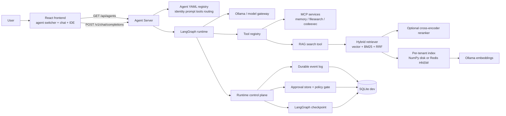
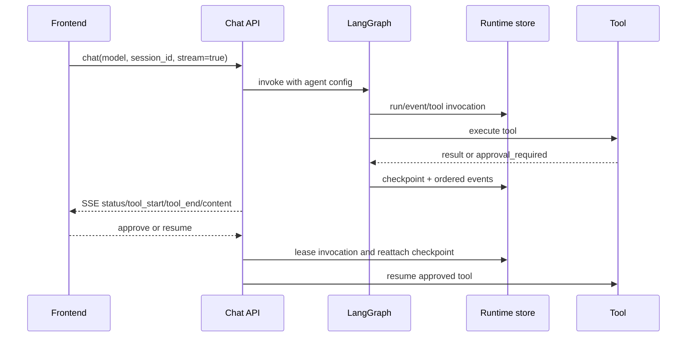

# Current Platform Architecture

> Updated 2026-07-31. This is the source of truth for the implemented local stack.

## System View



### Portable ASCII View

```text
                          +----------------------+
                          | User / Browser        |
                          +----------+-----------+
                                     |
                          +----------v-----------+
                          | React Frontend       |
                          | chat / IDE / switcher |
                          +----------+-----------+
                                     |
                  +------------------v------------------+
                  | Agent Server                         |
                  | /api/agents + /v1/chat/completions   |
                  +----+----------------------+----------+
                       |                      |
              +--------v--------+    +--------v---------+
              | YAML Agent       |    | LangGraph Runtime |
              | registry         |    | model + tools     |
              +------------------+    +----+---------+----+
                                            |         |
                              +-------------v-+   +---v----------------+
                              | MCP tools      |   | Runtime control     |
                              | memory         |   | events / approval   |
                              | filesearch     |   | checkpoint / resume |
                              | codeexec       |   +---------+-----------+
                              +----------------+             |
                                                         +----v-----+
                                                         | SQLite    |
                                                         | dev store |
                                                         +----------+

       RAG tool path from LangGraph:

       query -> vector search + BM25 -> RRF -> cross-encoder -> evidence answer
                         |                         |
                  NumPy disk or Redis HNSW     Ollama embeddings
```

## Implemented Agent Boundary

### Reliability and Production Boundary

The current local runtime uses `SQLiteRuntimeStore`. Its guarantees are
durability and cross-process recovery, but not multi-instance ownership or a
distributed work queue. The production target is the Postgres schema in
`platform/agent-server/migrations/001_runtime_postgres.sql`, paired with a
worker queue and lease-based invocation claims. The capability boundary is
explicit in `app/runtime/backend.py`; SQLite must not be described as a
production horizontal-scaling solution.

### Quality Control Plane

Evaluation artifacts carry `agent_id` and `run_type` (`smoke`, `full`, or
`qa`). Retrieval feedback can produce a candidate reranker artifact, but
promotion and rollback are separate operations. Tool-selection and answer
quality failures remain policy/eval inputs until a candidate passes its gate.

### Weak-Model Tool Contract

For high-confidence explicit intents such as “run Python” or “remember this”,
`app/agent/tool_routing/required_tools.py` detects a required tool. If the model returns a
plain answer without that tool, the graph performs one bounded structured-call
retry and names the missing tool. Ambiguous requests still fall through to the
model; this is a control-plane guard, not an unconditional keyword router.

Agents are resolved from `platform/agent-server/agents/*.yaml`. The frontend
catalog is server-driven by `GET /api/agents`; prompts, tools, guardrails, and
routing remain server-side.

| Agent | Tool posture | Intended use |
|---|---|---|
| `coding-agent` | filesystem, code execution, git, RAG | coding workspace |
| `customer-qa-agent` | read-only RAG and memory search | grounded support FAQ |
| `ops-agent` | investigation and operational tools | incident workflows |

The frontend keeps a separate session id and local transcript per agent. A
switch does not merge graph context across agents.

## Request and Recovery Flow



### Portable Recovery Flow

```text
  Browser            Chat API             LangGraph             Runtime Store
     |                  |                    |                       |
     |-- chat ---------->|                    |                       |
     |                  |-- invoke --------->|                       |
     |                  |                    |-- event/tool -------->|
     |                  |                    |<-- result ------------|
     |<-- SSE events ----|<-------------------|                       |
     |                  |                    |                       |
     |                  |                    |-- approval_required -->|
     |<-- approval UI ---|<-------------------|                       |
     |-- approve/resume->|                    |                       |
     |                  |-- lease + reattach ----------------------->|
     |                  |-- resume ---------->|                       |
     |<-- final SSE -----|<-------------------|-- completed ----------|
```

The event log is the runtime observability surface. LangGraph checkpoint owns
execution state; conversation history and long-term memory remain separate
stores with different ownership. SQLite is the development durability path.

## Customer QA RAG Flow

The demo corpus is under `platform/agent-server/knowledge/customer-qa/` and is
indexed per tenant and collection:

```text
public source -> markdown -> section chunk -> mxbai embedding
             -> embeddings.npy/chunks.json
             -> vector + BM25 + RRF -> cross-encoder -> grounded response
```

Redis Stack + RediSearch HNSW is an available production-oriented backend, but
the default local backend remains NumPy memory/disk. The index must eventually
carry embedding model/version, dimension, source URL, document version, update
time, tenant, and ACL metadata.

## Known Gaps

- Agent catalog is read-only; no admin UI or live editing yet.
- Customer QA feedback and retrieval traces are planned in M16.
- Index manifests and freshness/ACL filters are not complete.
- The frontend does not yet expose a full evidence panel or citation inspector.
- Redis is configured as an option, not the default acceptance backend.

## Model Adaptability

The runtime follows the model-adaptive design in
[Model-Adaptive Runtime Design](MODEL-ADAPTIVE-RUNTIME-DESIGN.md): safety
boundaries are invariant, while workflow strictness, tool exposure, context
budgets, planning freedom, and verifier frequency are profile-dependent.

See [Customer QA RAG Quality Design](CUSTOMER-QA-RAG-QUALITY-DESIGN.md).
