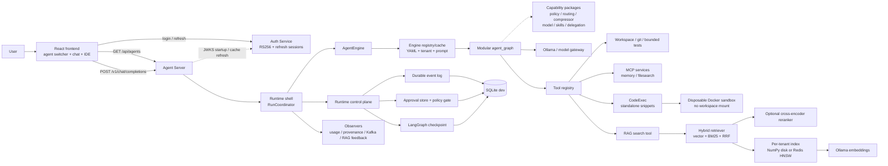
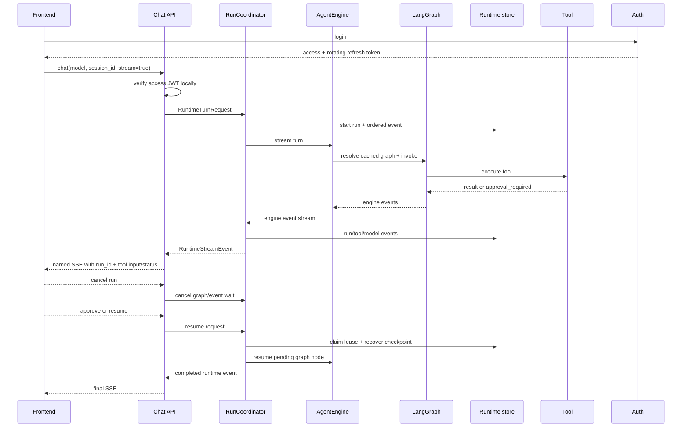

# Current Platform Architecture

> Updated 2026-08-27. This is the source of truth for the implemented local stack.

## System View



### Portable ASCII View

```text
Browser -> React -> FastAPI protocol adapters
         |
  RS256 access JWT -> verified AuthContext
  refresh-token row -> login session (Auth Service)
     |
         v
      Runtime shell: RunCoordinator
    runs/events | policy/approval | recovery | observers
         |
         v
    AgentEngine -> registry/cache -> modular agent_graph
               |
   execution_policy | tool_routing | compressor | model
         skills | delegation
               |
        model providers + authorized tool boundary
               |
      workspace / RAG / Java MCP / Docker CodeExec
               |
     SQLite dev store / Redis / Postgres / Kafka

       RAG tool path from LangGraph:

       query -> vector search + BM25 -> RRF -> cross-encoder -> evidence answer
                         |                         |
                  NumPy disk or Redis HNSW     Ollama embeddings
```

## Implemented Agent Boundary

### Reliability and Production Boundary

The current local runtime uses `SQLiteRuntimeStore`. Its guarantees are
durability and cross-process recovery, but not multi-instance ownership or a
distributed work queue. The production target is the Postgres schema in
`platform/agent-server/migrations/001_runtime_postgres.sql`, paired with a
worker queue and lease-based invocation claims. The capability boundary is
explicit in `app/runtime/backend.py`; SQLite must not be described as a
production horizontal-scaling solution.

Each turn has independent provider deadlines, output and response-buffer caps,
tool-call limits, cooperative cancellation, and a durable terminal reason.
Checkpoint state remains lossless; context compression creates an ephemeral
bounded model view instead of destructively rewriting recovery evidence.

### Quality Control Plane

Evaluation artifacts carry `agent_id` and `run_type` (`smoke`, `full`, or
`qa`). Retrieval feedback can produce a candidate reranker artifact, but
promotion and rollback are separate operations. Tool-selection and answer
quality failures remain policy/eval inputs until a candidate passes its gate.

### Weak-Model Tool Contract

For high-confidence explicit intents such as “run Python” or “remember this”,
`app/agent/tool_routing/required_tools.py` detects a required tool. If the model returns a
plain answer without that tool, the graph performs one bounded structured-call
retry and names the missing tool. Ambiguous requests still fall through to the
model; this is a control-plane guard, not an unconditional keyword router.

Observed Qwen2.5 7B failures define additional bounded adapters:

- exact malformed text envelopes are recovered only for allowlisted read tools;
- promised future actions such as `Next, we will read...` trigger one structured
  tool-call correction instead of being accepted as a final answer;
- exact duplicate calls are removed and repeated completed reads force synthesis;
- a tool burst is truncated to the turn's remaining hard allowance; once the
  allowance is exhausted, the model receives no tool schema and must summarize
  the evidence already collected.

These adapters constrain known protocol failures without converting arbitrary
model prose into writes or execution. A stronger model normally triggers them
less often but uses the same graph and safety boundary.

Agents are resolved from `platform/agent-server/agents/*.yaml`. The frontend
catalog is server-driven by `GET /api/agents`; prompts, tools, guardrails, and
routing remain server-side.

| Agent | Tool posture | Intended use |
|---|---|---|
| `coding-agent` | filesystem, bounded tests, standalone snippet execution, git, RAG | coding workspace |
| `customer-qa-agent` | read-only RAG and memory search | grounded support FAQ |
| `ops-agent` | investigation and operational tools | incident workflows |

The frontend keeps a separate session id and local transcript per agent. A
switch does not merge graph context across agents.

Tool events are first-class user-visible records. The frontend correlates them
by `run_id + seq` and displays actual path/range/query/command/code plus
running/success/error state in causal order before the final answer.

### Authentication, Sessions, and Workspace Ownership

Access JWTs remain stateless at Agent Server: middleware verifies each protected
request locally with a process-wide JWKS cache, then route dependencies reuse an
auth-owned marked `AuthContext` rather than verifying twice. Auth Service owns
rotating refresh-token rows, which are the login-session abstraction.

The following identifiers are intentionally not interchangeable:

| Dimension | Identity | Authority |
|---|---|---|
| Caller | verified access JWT | authorization and tenant identity |
| Login continuity | refresh-token row | rotation and logout revocation |
| Conversation | tenant-prefixed `session_id` | message/checkpoint continuity only |
| Execution | `run_id` | events, cancellation, approval, retry, audit |
| Workspace | immutable path captured in run metadata | filesystem/tool boundary for that run |

Multi-tenant workspace mode confines selection to a collision-resistant tenant
directory. Single-user local mode may browse allowed home/tmp roots, but every
Agent file operation still resolves a relative path, checks canonical
containment, and rejects escaping symlinks. A workspace switch remounts the
frontend session and does not mutate the path snapshot of an in-flight run.

Agent-to-MCP calls obtain audience-specific RS256 service tokens from Auth
Service and propagate tenant identity as a signed claim. CodeExec only accepts
service identity and runs standalone Python/JavaScript/shell snippets inside a
hardened disposable container. It deliberately does not mount the workspace;
there is no general `run_project` capability.

## Request and Recovery Flow



### Portable Recovery Flow

```text
  Browser      Chat API      RunCoordinator      AgentEngine       Runtime Store
     |             |               |                  |                 |
     |-- chat ---->|               |                  |                 |
     |             |-- request --->|-- start run --------------------->|
     |             |               |-- stream turn -->|                 |
     |             |               |<-- engine events-|                 |
     |             |               |-- ordered events ---------------->|
     |<-- SSE ------|<-- runtime ---|                  |                 |
     |-- resume --->|-------------->|-- claim lease ------------------->|
     |             |               |-- resume graph ->|                 |
     |<-- final SSE-|<--------------|<-- completed ----|                 |
```

The event log is the runtime observability surface. Optional observers consume
runtime observations without owning execution outcomes. LangGraph checkpoint owns
execution state; conversation history and long-term memory remain separate
stores with different ownership. SQLite is the development durability path.

## Customer QA RAG Flow

The demo corpus is under `platform/agent-server/knowledge/customer-qa/` and is
indexed per tenant and collection:

```text
public source -> markdown -> section chunk -> mxbai embedding
             -> embeddings.npy/chunks.json
             -> vector + BM25 + RRF -> cross-encoder -> grounded response
```

Redis Stack + RediSearch HNSW is an available production-oriented backend, but
the default local backend remains NumPy memory/disk. The index must eventually
carry embedding model/version, dimension, source URL, document version, update
time, tenant, and ACL metadata.

## Known Gaps

- Agent catalog is read-only; no admin UI or live editing yet.
- Feedback and retrieval-trace capture use local JSONL; production retention,
  ACLs, analytics storage, and review workflow are not complete.
- Index manifests and freshness/ACL filters are not complete.
- The frontend does not yet expose a full evidence panel or citation inspector.
- Redis is configured as an option, not the default acceptance backend.
- Runtime approval/checkpoint machinery exists, but the default policy evaluator
  remains log-only allow; a production deny/approval rule set is not configured.
- `RuntimeProfile.verification_enabled` is parsed but not yet wired into the
  graph; reflexion remains controlled by the global setting.
- CodeExec is a snippet sandbox without a workspace mount. A safe `run_project`
  tool still needs explicit approval, startup detection, deadlines, process-tree
  cleanup, port handling, and audit semantics.
- Agent Server does not consult the Auth blacklist on every access-JWT request;
  logout revokes refresh sessions immediately, while an issued access token may
  remain valid until its short expiration.
- Refresh concurrency is covered on H2, not yet by PostgreSQL/Testcontainers.

## Model Adaptability

The runtime follows the model-adaptive design in
[Model-Adaptive Runtime Design](MODEL-ADAPTIVE-RUNTIME-DESIGN.md): safety
boundaries are invariant, while workflow strictness, tool exposure, context
budgets, planning freedom, and verifier frequency are profile-dependent.

The implemented profile currently owns the model/provider, hard tool-call and
context budgets, subagent exposure, and deterministic direct-read routing. The
local Qwen profile uses a compact sequential loop; stronger local or API models
can use larger budgets and, after evaluation, broader planning/subagent options.
Provider-native adapters translate the same output/deadline contract to Ollama,
MLX/OpenAI-compatible, OpenAI, or Anthropic clients.

Changing the model therefore does not require a new architecture. It changes
the frequency and value of planning, verification, parallelism, and fallback,
while these invariants remain fixed:

1. authenticated tenant and workspace containment;
2. policy and approval at the execution boundary;
3. idempotency, leases, cancellation, and terminal-state semantics;
4. provider/resource ceilings and durable audit events;
5. outcome-based E2E evaluation with hidden tests and control arms.

This separation exists because model behavior is stochastic and hardware-
dependent, while identity, side effects, recovery, and evidence must remain
deterministic and inspectable.

See [Customer QA RAG Quality Design](CUSTOMER-QA-RAG-QUALITY-DESIGN.md).
