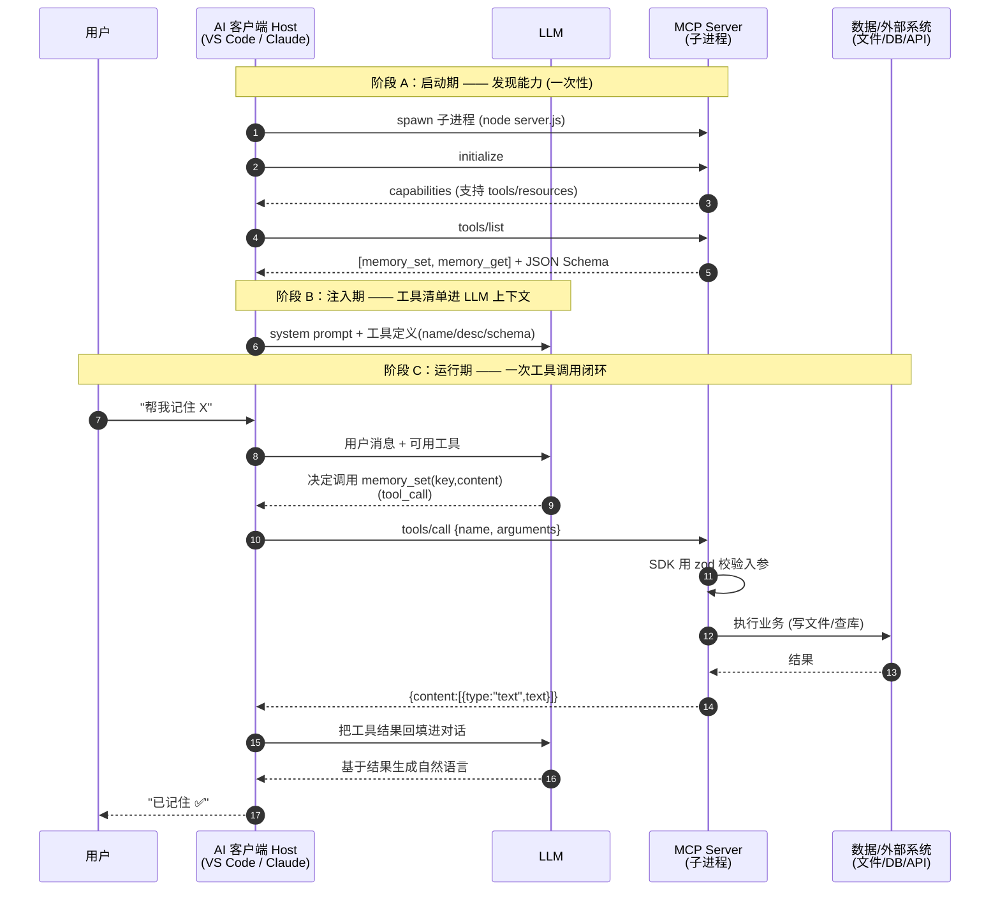

# MCP Server 教学骨架

这个目录用最小骨架讲清 MCP Server 的**原理 / 规范 / 开发流程**。

- `memory-server-minimal.ts` — 2 个工具（`memory_set` 写 + `memory_get` 读）的自包含骨架，~130 行
- 对照物：`../memory-server.ts` — 生产版（11 工具 + WAL + 遗忘曲线 + skill 提取）

> 核心思路：**搞懂一个 tool 的完整往返，其余 tool / resource 全是同一套路。**

---

## 一、原理：MCP Server 是什么？

MCP（Model Context Protocol）是 AI 客户端（VS Code Copilot、Claude Desktop、Codex 等）
和外部能力之间的标准协议。Server 把「工具 / 资源」暴露出去，client 里的 LLM 按需调用。

**stdio 模式的本质**：client 把 server 当**子进程**拉起来，双方通过
`stdin` / `stdout` 收发 **JSON-RPC 2.0** 消息。

```
AI 客户端(VS Code)                    子进程 (MCP Server)
     │                                      │
     │  1. initialize          ─────────►   │  握手 + 声明能力
     │  ◄────────── capabilities            │
     │                                      │
     │  2. tools/list          ─────────►   │  返回工具清单
     │  ◄──── [name/desc/schema]            │  (LLM 据此决定调谁)
     │                                      │
     │  3. tools/call          ─────────►   │  SDK 校验入参 → handler
     │  ◄──── {content:[{text}]}            │
```

> ⚠️ **铁律**：stdout 是协议通道，业务代码**绝不能 `console.log`**（会污染协议流）。
> 所有日志走 `console.error`（stderr），client 会忽略。

---

## 一·五、完整数据流：从"发现 MCP"到"拿到结果"

上面的时序图只画了 server 一侧。真实闭环里还有 **LLM** 和 **用户**。
下面这张把 5 个角色都放进去——这是理解 MCP 最重要的一张图。



### 三个阶段拆解

**阶段 A：发现能力（启动时一次）**
- Host 把 server 当子进程拉起来 → `initialize` 握手 → `tools/list` 取回工具清单。
- 关键产物：每个工具的 `name` / `description` / `inputSchema`。

**阶段 B：注入 LLM（把工具"告诉"模型）**
- ★ 这一步很多人忽略：**LLM 本身不认识你的 server**。
- Host 把工具定义**塞进发给 LLM 的请求里**（system prompt 或专门的 tools 字段）。
- 所以 `description` 写得好不好，直接决定 LLM 会不会、以及何时调用你的工具。
- 也解释了为什么"工具越多越贵"——每个工具定义每轮都占 token。

**阶段 C：运行闭环（每次调用）**
1. 用户提需求 → Host 连同工具清单发给 LLM
2. LLM 判断该调哪个工具，吐出 `tool_call`（结构化的 name + arguments）
3. **Host 是中间人**：把 `tool_call` 翻译成 `tools/call` JSON-RPC 发给 server
4. Server 端 SDK 用 zod 校验 → handler 执行业务 → 返回 `{content:[{text}]}`
5. Host 把结果**回填**进对话，再次发给 LLM
6. LLM 基于真实结果生成回答 → Host 展示给用户

> 🔑 三个要点：
> - **LLM 不直接碰 server**，全程由 Host 代理转发。
> - **LLM 只做决策**（调谁、传什么参数），不执行——执行在 server。
> - **一次工具调用 = 两趟 LLM 往返**（决策一趟 + 拿结果生成回答一趟）。

---

## 二、规范：一个 tool 的四要素

```ts
server.tool(
  "memory_set",                                    // ① 名字：LLM 看到的函数名
  "Save a memory under a unique key.",             // ② 描述：LLM 判断"何时调用"的唯一依据
  { key: z.string(), content: z.string() },        // ③ schema：zod → 自动转 JSON Schema
  async ({ key, content }) => {                     // ④ handler：纯业务逻辑
    /* ... */
    return textResult("✅ Created");                // 返回值必须是 {content:[{type,text}]}
  }
);
```

两条强制约定：

1. **返回值形状固定**：`{ content: [{ type: "text", text }] }` —— 用 `textResult()` 封装复用。
2. **错误内部消化**：handler 绝不 `throw`，"没找到"也返回正常 text，让 LLM 自己决定下一步。

---

## 三、开发流程

```bash
1. npm init && npm i @modelcontextprotocol/sdk zod
2. 写 server.ts：new McpServer() → server.tool() → main() 连 StdioServerTransport
3. tsc 编译 → dist/*.js
4. 在 AI 客户端的 config 里注册（见下）
5. 重启 client 的 MCP server，生效
```

---

## 四、实测：一次完整的 JSON-RPC 会话

下面是**真实跑出来的** trace（`node dist/memory-server-minimal.js` 喂入请求）。
可直接投屏，边讲边对照代码。

### ① 握手 `initialize`
请求：
```json
{"jsonrpc":"2.0","id":1,"method":"initialize","params":{"protocolVersion":"2024-11-05","capabilities":{},"clientInfo":{"name":"demo","version":"1.0"}}}
```
响应（server 亮身份 + 声明支持 tools）：
```json
{
  "result": {
    "protocolVersion": "2024-11-05",
    "capabilities": { "tools": { "listChanged": true } },
    "serverInfo": { "name": "memory-store-minimal", "version": "1.0.0" }
  },
  "jsonrpc": "2.0", "id": 1
}
```

### ② 列工具 `tools/list`
响应（★注意：你写的 zod 被 SDK 自动转成了 JSON Schema）：
```json
{
  "result": {
    "tools": [
      {
        "name": "memory_set",
        "description": "Save a memory: store a piece of text under a unique key.",
        "inputSchema": {
          "$schema": "http://json-schema.org/draft-07/schema#",
          "type": "object",
          "properties": {
            "key": { "type": "string", "description": "Unique identifier for this memory" },
            "content": { "type": "string", "description": "The text content to remember" }
          },
          "required": ["key", "content"]
        }
      },
      { "name": "memory_get", "description": "Retrieve a memory by its exact key.", "inputSchema": { "...": "..." } }
    ]
  },
  "jsonrpc": "2.0", "id": 2
}
```
> 讲点：`.optional()` 与否 → 直接决定 `required` 数组。参数描述就是 LLM 的"说明书"。

### ③ 调用写入 `tools/call` → memory_set
```json
请求: {"jsonrpc":"2.0","id":3,"method":"tools/call","params":{"name":"memory_set","arguments":{"key":"demo","content":"hello mcp"}}}
响应: {"result":{"content":[{"type":"text","text":"✅ Created: \"demo\""}]},"jsonrpc":"2.0","id":3}
```

### ④ 调用读回 `tools/call` → memory_get
```json
请求: {"jsonrpc":"2.0","id":4,"method":"tools/call","params":{"name":"memory_get","arguments":{"key":"demo"}}}
响应: {"result":{"content":[{"type":"text","text":"hello mcp"}]},"jsonrpc":"2.0","id":4}
```
> 写进 `hello mcp`，读出 `hello mcp` —— 一个 tool 的完整往返闭环。

### 自己复现```bash
# 编译
./node_modules/.bin/tsc teaching/memory-server-minimal.ts --outDir teaching/dist \
  --module Node16 --moduleResolution Node16 --target ES2022 \
  --esModuleInterop --skipLibCheck --types node --ignoreConfig

# 喂一串请求进去
(
  printf '%s\n' '{"jsonrpc":"2.0","id":1,"method":"initialize","params":{"protocolVersion":"2024-11-05","capabilities":{},"clientInfo":{"name":"demo","version":"1.0"}}}'
  printf '%s\n' '{"jsonrpc":"2.0","method":"notifications/initialized"}'
  printf '%s\n' '{"jsonrpc":"2.0","id":2,"method":"tools/list"}'
  printf '%s\n' '{"jsonrpc":"2.0","id":3,"method":"tools/call","params":{"name":"memory_set","arguments":{"key":"demo","content":"hello mcp"}}}'
  printf '%s\n' '{"jsonrpc":"2.0","id":4,"method":"tools/call","params":{"name":"memory_get","arguments":{"key":"demo"}}}'
  sleep 0.5
) | node teaching/dist/memory-server-minimal.js 2>/dev/null
```

---

## 四·五、延伸：JSON-RPC 是什么？为什么 MCP 用它？

> 面向有后端背景的读者。搞懂这一节，就理解了 MCP 为什么"能跑在 stdio 管道上"。

### 先分层：Netty / JSON-RPC / gRPC / Dubbo 根本不是一类东西

常见误区是把它们平行对比，其实它们在不同层：

```
┌─────────────────────────────────────────────┐
│  服务治理层   Dubbo / Spring Cloud            │  ← 注册发现/熔断/负载均衡
├─────────────────────────────────────────────┤
│  RPC 协议层   JSON-RPC │ gRPC │ dubbo 协议     │  ← 消息格式 + 调用语义
├─────────────────────────────────────────────┤
│  序列化       JSON     │ Protobuf │ Hessian    │
├─────────────────────────────────────────────┤
│  传输层       stdio/HTTP│ HTTP/2 │ TCP(Netty)  │  ← Netty 活在这一层
└─────────────────────────────────────────────┘
```

| 名称 | 它到底是什么 | 类比 |
|------|------------|------|
| **Netty** | 网络 I/O 框架（只管传输层收发字节） | 发动机+底盘 |
| **JSON-RPC** | 一个 RPC 协议规范（只管消息长什么样） | 信件格式 |
| **gRPC** | 协议+序列化+传输+代码生成 全家桶 | 一整辆车 |
| **Dubbo** | RPC + 服务治理框架（Netty 做传输） | 车队+调度中心 |

### JSON-RPC 2.0 规范：字段是封闭的，不是"自由发挥"

顶层字段固定，规范禁止乱加成员。真正自由的只有 `params` / `result` **内部**。

**请求**：
```json
{ "jsonrpc": "2.0", "method": "memory_set", "params": { ... }, "id": 1 }
```
**响应**（`result` 与 `error` 二选一）：
```json
{ "jsonrpc": "2.0", "id": 1, "result": { ... } }
{ "jsonrpc": "2.0", "id": 1, "error": { "code": -32601, "message": "Method not found" } }
```

MCP 的 `tools/call` 就是把自己的应用层塞进 `params` 里：
```json
{"jsonrpc":"2.0","id":3,"method":"tools/call",
 "params":{"name":"memory_set","arguments":{"key":"demo"}}}
              └──── 这团是 MCP 自定义的负载, JSON-RPC 不管 ────┘
```
> 即：**MCP = JSON-RPC(信封) + MCP 自己的应用协议(信纸内容)**。

### 规范还定了 4 条"信封语义"

1. **`id` 配对** —— 请求带 id，响应回同一个 id，用于同一连接上并发多请求的响应配对。
2. **Notification（通知）** —— **没有 `id`** 就是单向不回复，例如 `notifications/initialized`。
3. **标准错误码** —— `-32700` Parse error / `-32600` Invalid Request / `-32601` Method not found / `-32602` Invalid params / `-32603` Internal error。
4. **Batch** —— 用数组一次发多个请求。

### 为什么它够格叫 "RPC"？

RPC 的内核就一句：**让"调远程方法"在形式上像"调本地函数"——给方法名和参数，拿回返回值。**

| RPC 要素 | JSON-RPC 字段 | 类比 Java |
|---------|--------------|-----------|
| 方法名 | `method` | `memoryService.set(...)` 的方法名 |
| 入参 | `params` | 方法参数 |
| 返回值 | `result` | 返回值 |
| 异常 | `error` | 抛出的异常 |
| 调用配对 | `id` | —— |

所以它叫 RPC，是因为抽象的是"**调一个方法拿回结果**"，而非"传一坨数据"。

### 和 gRPC/Dubbo 比，它是"RPC 的最小合格实现"

| 能力 | JSON-RPC | gRPC | Dubbo |
|------|:--------:|:----:|:-----:|
| method+params+result+id | ✅ | ✅ | ✅ |
| 强类型契约(IDL) | ❌ 靠文档 | ✅ .proto | ✅ 接口 |
| 代码生成(stub) | ❌ 手写 | ✅ | ✅ |
| 二进制高效序列化 | ❌ 纯 JSON | ✅ Protobuf | ✅ Hessian |
| 传输绑定 | ❌ 任意 | HTTP/2 | TCP |

### 结论：MCP 为什么选 JSON-RPC 而不是 gRPC

1. **传输无关** → MCP 要跑在 **stdio 子进程管道**上；gRPC 绑死 HTTP/2 做不到。
2. **零依赖、可读** → 不用 protoc、不用编 `.proto`；`console.error` 打出来就是能读的 JSON，调试友好。
3. **场景不需要高性能** → 本地进程间偶发调用，不是每秒万次的微服务，Protobuf 的优势用不上。
4. **跨语言门槛极低** → 任何语言能读写 JSON 就能实现。

> 一句话：**要的就是这份"薄"**——JSON-RPC 只保住 RPC 的语义内核，把序列化/传输/契约全部留白，完美契合本地 stdio 子进程这种朴素场景。

---

## 五、把写好的 Server 注册到 AI 工具

编译产物是 `dist/memory-server-minimal.js`。不同 client 的注册方式如下——
**格式几乎一致**（stdio 模式都是 `command` + `args` + 可选 `env`）。

### 1. VS Code (GitHub Copilot)

工作区级：`.vscode/mcp.json`
```jsonc
{
  "servers": {
    "memory-minimal": {
      "type": "stdio",
      "command": "node",
      "args": ["${workspaceFolder}/platform/mcp-cli/dist/memory-server-minimal.js"],
      "env": { "SOME_FLAG": "value" }   // 可选：传环境变量给 server
    }
  }
}
```
> 注意 VS Code 用的是顶层 `"servers"` 键。改完在命令面板运行
> **MCP: Restart Server** 或重启窗口生效。

### 2. Claude Desktop

`~/Library/Application Support/Claude/claude_desktop_config.json` (macOS)
```json
{
  "mcpServers": {
    "memory-minimal": {
      "command": "node",
      "args": ["/absolute/path/to/dist/memory-server-minimal.js"]
    }
  }
}
```
> 注意用顶层 `"mcpServers"` 键，且**必须绝对路径**（不支持 `${workspaceFolder}`）。
> 改完完全退出并重启 Claude Desktop。

### 3. Codex CLI / Codex IDE

`~/.codex/config.toml`
```toml
[mcp_servers.memory-minimal]
command = "node"
args = ["/absolute/path/to/dist/memory-server-minimal.js"]

[mcp_servers.memory-minimal.env]
SOME_FLAG = "value"
```
> Codex 用 TOML；每个 server 一个 `[mcp_servers.<name>]` 段。

### 4. Cursor

`~/.cursor/mcp.json`（全局）或项目内 `.cursor/mcp.json`
```json
{
  "mcpServers": {
    "memory-minimal": {
      "command": "node",
      "args": ["/absolute/path/to/dist/memory-server-minimal.js"]
    }
  }
}
```

### 各家配置对照

| 客户端 | 配置文件 | 顶层键 | 格式 | 路径 |
|--------|---------|--------|------|------|
| VS Code Copilot | `.vscode/mcp.json` | `servers` | JSONC | 支持 `${workspaceFolder}` |
| Claude Desktop | `claude_desktop_config.json` | `mcpServers` | JSON | 需绝对路径 |
| Codex | `~/.codex/config.toml` | `[mcp_servers.*]` | TOML | 需绝对路径 |
| Cursor | `.cursor/mcp.json` | `mcpServers` | JSON | 需绝对路径 |

> 共同点：stdio 模式 = 告诉 client「**用什么命令拉起我的进程**」。
> `command` + `args` 拼起来就是 `node /path/to/server.js`，client 拉起后即通过
> stdin/stdout 走 JSON-RPC。所以只要能被 `node` 执行，注册就是几行配置的事。

### 排错 checklist
- 用了绝对路径吗？（Claude/Codex/Cursor 不认 `${workspaceFolder}`）
- server 里有没有误用 `console.log`？（污染 stdout → client 报协议错误）
- 编译产物存在吗？（`ls dist/memory-server-minimal.js`）
- 改完配置**重启了 client / MCP server**吗？
